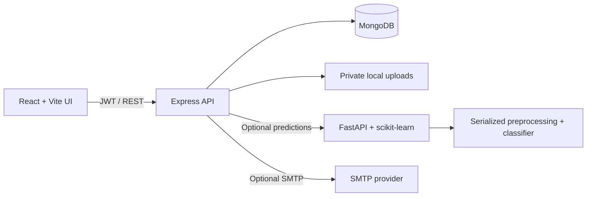

# Architecture

## Components

- `frontend/`: responsive React SPA, protected routes, shared Axios client, role-aware navigation and Recharts visualizations.
- `backend/`: Express REST API, Mongoose models, JWT authorization, request validation, audit records, task/case services, private uploads and notification/reminder handling.
- `ml-service/`: deterministic synthetic record generator, training/evaluation scripts and FastAPI prediction endpoint. Model training/preprocessing live in a single scikit-learn pipeline to prevent test leakage.
- `docker-compose.yml`: local MongoDB container with persistent named volume.

## Trust boundaries

The browser stores the short-lived bearer token in local storage for this local demo. The API verifies tokens and independently applies role and case-assignment restrictions. Passwords are bcrypt-hashed. MongoDB, SMTP credentials and the ML URL remain server-side. Uploaded documents are stored outside the static frontend and downloaded only through an authenticated, case-scoped API route.

SMTP and the ML service are optional. Missing SMTP never blocks in-app alerts. A missing/unreachable ML service selects the deterministic local risk heuristic and the UI discloses that source. Google Calendar is not configured; only the internal event feed is implemented.
